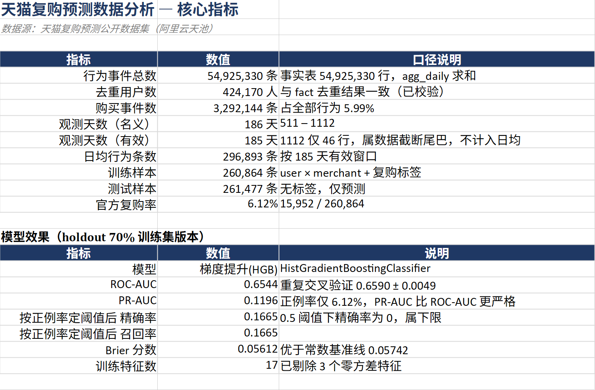
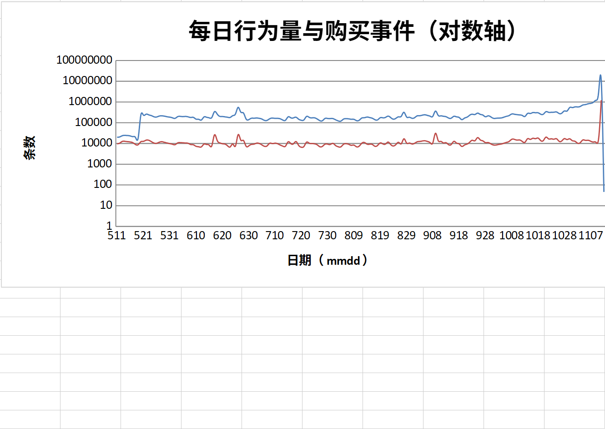

# 国内电商用户行为分析与复购运营平台

[](https://github.com/tingnan1/nsl/actions/workflows/ci.yml)
[](LICENSE)

基于天猫复购预测公开数据集的完整数据分析链路：**真实数据 → 清洗 → MySQL 星型模型 → SQL 分析 → Python 统计与可视化 → 运营指标体系 → 复购预测模型**。

> 数据来源：[阿里云天池「天猫复购预测」数据集](https://tianchi.aliyun.com/dataset/161265)（比赛公开数据，已脱敏）。
> 本项目所有数字均由本地代码从这份数据实际计算得出，没有使用任何估算值、占位值或模拟数据。

📄 **想一次看完结论，读 [docs/PROJECT_REPORT.md](docs/PROJECT_REPORT.md)**（完整项目报告：摘要、关键发现、建模、工程实现、踩坑记录、局限）
🎯 **只想知道该做什么，读 [docs/BUSINESS_INSIGHTS.md](docs/BUSINESS_INSIGHTS.md)**（5 条洞察，每条含发现 / 解释 / 可执行动作 / 可验证指标）
📊 **想直接看数据，打开 [dashboard/tmall_analytics.xlsx](dashboard/tmall_analytics.xlsx)**（Excel 看板，双击即可，无需安装任何软件）



## 项目亮点

- **不是玩具数据**：5492 万条真实行为日志、424,170 个真实脱敏用户，全部指标由本地代码实际计算，附 19 项硬校验与字节级可复现的清洗产物。
- **口径严谨到能抵抗追问**：把「购买用户占比恒为 100%」「加购→购买重叠率 100%」「准确率 93.88%」这些**看起来漂亮但没有信息量的假信号**主动标出来，并说明为什么不能用。
- **数据库不是摆设**：9 张主表 + 3 张物化聚合表，`date_key` 分区裁剪实测生效；11 条分析查询逐条 `EXPLAIN` 审计，并实测出「全期累计查询要 376 秒」——因此接口改为读物化表（59 s → 0.004 s）。
- **模型给的是可执行结论**：不只报 AUC，还给业务换算——只触达前 10% 人群能多捞 **654 个真实复购用户**（随机挑选的 2.37 倍），同时说明概率校准的边界（Brier 只比基准线好 2.3%，不能当单人承诺）。
- **工程化程度**：34 项测试 + GitHub Actions CI（lint / 构建 / 单测）+ ruff 全绿 + 环境自检脚本，克隆下来按 README 步骤可复现。

---

## 1. 项目解决了什么

电商运营的核心问题之一是：**11.11 当天买过我的人，之后还会不会回来复购？** 这个项目用 5492 万条真实用户行为日志，把「看数据 → 出指标 → 建模型」这条链路完整跑通，并如实标出每一步的**口径限制**。

项目同时记录了 5 个实际遇到的工程问题及其定位过程与解法（中文计算机名导致 mysqld 无法启动、分区裁剪失效、带索引装载慢 28 倍、PowerShell 脚本编码、LOAD DATA 中文路径）。

### 具体回答的问题

1. 这份数据的规模、结构、质量到底如何？有没有断档、缺失、异常？
2. 用户行为在 186 天里的趋势是什么？双十一当天的强度是平日的多少倍？
3. 点击 / 加购 / 收藏 / 购买四类行为的结构与人群重叠情况如何？（哪些重叠率是假信号？）
4. 用户、商家、品类的分布有多集中？头部占多少？
5. 哪些指标**算不出来**？为什么算不出来？（9 项指标已被明确排除）
6. 在双十一买过之后，谁更可能再次购买？分群差异有多大，是不是噪声？
7. 能不能用模型把「更可能复购的人」排到前面？排序能力和绝对概率分别有多可信？
8. 把这些结论搬进可用的系统需要什么？接口要几秒、看板长什么样？

## 2. 数据规模（实测）

| 文件 | 行数 | 内容 |
|---|---|---|
| `user_log_format1.csv` | **54,925,330** | 用户行为日志（1.78 GB 原始 / 2.30 GB 清洗后） |
| `user_info_format1.csv` | 424,170 | 用户画像（年龄区间、性别） |
| `train_format1.csv` | 260,864 | 训练样本（用户 × 商家 + 复购标签） |
| `test_format1.csv` | 261,477 | 测试样本（`prob` 全空，待预测） |

行为类型分布（实测）：点击 48,550,713 / 加购 76,750 / 购买 3,292,144 / 收藏 3,005,723。
`brand_id` 缺失 91,015 条——**导入时用 `NULLIF` 转 NULL，绝不能写成 0**，否则「缺失」会变成「真实的零」。

## 3. 完成度

| 阶段 | 内容 | 状态 |
|---|---|---|
| Phase 0–3 | 数据获取、质量检查、清洗 | ✅ 复跑验证，产物 SHA256 字节级一致 |
| Phase 4 | MySQL 星型模型（9 表，按月分区） | ✅ **19 项硬校验全部 PASS** |
| Phase 5 | SQL 分析（窗口函数、帕累托、分区裁剪） | ✅ 11 个章节，与 Python 结果交叉验证一致 |
| Phase 6 | Python 统计与可视化 | ✅ 11 张表 / 10 张图 / 报告 |
| Phase 7 | 运营指标体系 | ✅ 指标字典 + 5 张表 + 报告 |
| Phase 8 | 复购预测建模 | ✅ HGB ROC-AUC 0.6544，5 折 CV 0.6590 |
| Phase 9 | Power BI Dashboard | 🔶 数据导出完成（9 张 CSV），.pbix 需本机 Power BI Desktop |
| Phase 10 | FastAPI 后端 | ✅ 12 个接口，全部查真实数据库 |
| Phase 11–12 | Vue 3 前端 + 联调 | 🔶 看板完成、8 个接口全部接通（构建通过），待人工过一遍页面 |
| Phase 13–15 | 测试、部署、报告 | ✅ 40 项测试 / 单端口部署 / 完整项目报告（演示 PPT 按需求暂不做） |

## 4. 关键发现（都可复现）

### 4.1 这份数据全部是「11.11 买家」

424,170 个用户**全部**在 1111 当天出现过，且**每人至少一次购买**。1111 当天的用户集合与全量用户集合**完全相等**（用两套独立实现交叉验证过）。

这意味着：`购买用户占比 = 100%` 是抽样口径的必然结果，**没有信息量**，谁把它当转化率讲都是错的。

### 4.2 日志在 1111 就结束了

1112 只有 **46 行、0 次购买**。所以**无法用本日志构造「1111 之后是否再购买」的标签**——复购标签只能沿用比赛方给出的 `label`（其观测窗口不在我们拿到的数据里）。这直接决定了 Phase 8 的建模方式：特征只能用 1111 及之前的行为。

### 4.3 0519 → 0520 有 12.22 倍结构性断层

| 日期 | 行为条数 | 日环比（`LAG` 计算） |
|---|---|---|
| 0519 | 18,430 | -4.22% |
| **0520** | **225,198** | **+1121.91%** |

前 9 天日均仅 21,680 条，之后日均 309,210 条。判断为早期数据采集覆盖不完整，**「全期日均」会严重低估后半段强度**。

### 4.4 双十一：购买放大 88.98 倍，远超行为总量的 8.97 倍

| 指标 | 前 7 天日均 | 1111 当天 | 倍数 |
|---|---|---|---|
| 行为条数 | 1,179,264 | 10,582,633 | 8.97× |
| 购买事件 | 13,749 | 1,223,354 | **88.98×** |

说明 1111 不只是「人变多」，更是**单位行为的转化效率大幅提升**。

### 4.5 老客复购率显著高于新客

| 分层（1111 前是否购买） | 样本数 | 复购率 |
|---|---|---|
| 老客（有购买） | 211,874 | **6.40%** |
| 新客（无购买） | 48,990 | 4.90% |

相差 +1.50 个百分点。**这是相关性，不是因果**——老客可能本身需求就更强，要判断因果需要对照实验，本数据做不到。

### 4.6 商家复购率随体量上升，但小样本会造假极值

| 商家样本量分组 | 商家数 | 平均复购率 | 最高复购率 |
|---|---|---|---|
| ≥500 | 111 | **7.11%** | 29.04% |
| 100–499 | 476 | 5.42% | 28.19% |
| 30–99 | 927 | 5.22% | 43.24% |
| **<30（不参与排名）** | 479 | 5.57% | **52.94%** |

样本量 <30 的组里出现 52.94% 的极端复购率——这正是小样本噪声，**印证了「小样本不参与排名」这条规则的必要性**。

## 5. 复购预测模型

| 模型 | ROC-AUC | PR-AUC | 按正例率定阈后的 F1 |
|---|---|---|---|
| 基线：全预测 0 | 0.5000 | 0.0612 | 0.1153（假象，见报告） |
| 基线：规则排序 | 0.5530 | 0.0826 | 0.1212 |
| 逻辑回归 | 0.6227 | 0.1054 | 0.1454 |
| 随机森林 | 0.6396 | 0.1117 | 0.1536 |
| **梯度提升 HGB** | **0.6544** | **0.1196** | **0.1665** |

5 折交叉验证 ROC-AUC **0.6590 ± 0.0049**。只触达分数最高 10% 人群时，精确率 0.1448、召回率 0.2367，是随机挑选的 **2.37 倍**。

**AUC 0.65 不算高，如实说明原因**：正例率只有 6.12%，且特征窗口只到 1111，而复购行为发生在窗口之外，这份数据能提供的信息本身有限。

建模时剔除的特征也值得注意：`p_has_buy`、`p_last_buy_recency`、`p_last_recency` 在全部 260,864 个训练样本和 261,477 个测试样本上都是常量——因为所有样本都满足「已在该商家买过」。

**产物口径**：仓库里的 `outputs/models/repurchase_model.joblib`（703 KB，已入库）是**全量训练集**拟合的版本，与 `prediction_test.csv` 同源；上表的 holdout 指标来自 **70% 训练集**那一版。两者都对，但引用时不能张冠李戴。同目录的 `repurchase_model_meta.json` 记录了特征列表、训练行数、正例率、两套阈值下的指标和库版本，克隆下来不用重训就能核对。

**概率校准**（比 AUC 更能说明能不能用）：Brier 分数 **0.05612**，优于常数基准线 0.05742（改善 2.3%）。按预测概率十分位分组，十个分位的**偏差绝对值最大只有 0.0074**，最高分位预测 13.89%、实际 14.48%——**概率本身基本可信**。但 Brier 改善幅度小，说明大多数样本都贴近 6.12% 的基准率，**绝对区分度有限**。结论：可做相对排序与期望人数估算，不宜当单个用户的精确承诺。详见 [phase8_model.md](outputs/reports/phase8_model.md) 第 6 节。

**业务价值**：只触达前 10% 人群（7,826 人），模型命中 1,133 个真实复购用户；同样人数随机挑选只能命中约 478 个——**同样的触达预算，多捞回 654 个真实复购用户**（2.37 倍）。收窄到前 1% 时精确率是基准率的 3.72 倍。

**稳健性**：5 折 × 3 轮共 15 次重复评估，ROC-AUC 均值 **0.6595 ± 0.0038**，极差仅 0.0148。这不是某次数据划分撞出来的高值。

**共线性**：`seller_buys` 与 `seller_buyers` 的 VIF 分别为 20.60 / 20.47、相关系数 0.974——它们正好是重要性排名前二的特征，所以 permutation 重要性在这两者之间被摊薄，不能只看单个数字判断特征价值。

## 6. 数据库设计

`tmall_analysis` 库，**9 张主表**（事实表 `fact_user_log` + 6 张维度表 + 2 张样本表），另加 **3 张物化聚合表**（`agg_daily` / `agg_action_summary` / `agg_segment_repurchase`，用于把接口从分钟级降到毫秒级）。

- **列类型由实测取值范围决定**：`user_id` 最大 424,170 → `MEDIUMINT`；`cat_id` 最大 1,671 → `SMALLINT`。5492 万行上比全用 `INT` 省约 440 MB。
- **事实表不建代理主键**：分析只做聚合，二级索引够用；重载用分区 `TRUNCATE`。再省近 1 GB。
- **按 `date_key` 分区**（不是按 `month`）：实测按 `month` 分区时，`date_key` 上的范围条件无法裁剪，`EXPLAIN` 显示 8 个分区全扫；改成 `RANGE(date_key)` 后只扫 `p11`，且 `Using index`。
- **`dim_date.is_weekend` 故意留 NULL**：数据没有年份，无法确定星期几。没有确凿出处就不编造。

### 6.1 执行计划审计：把「性能」从感觉变成证据

`python/explain_audit.py` 把 `sql/analysis.sql` 拆成 11 条查询逐条 `EXPLAIN` 并实测耗时，结果写在 [phase5_explain_audit.md](outputs/reports/phase5_explain_audit.md)：

| 查询 | 实测耗时 | 说明 |
|---|---|---|
| 总览（行数 + 去重用户） | **59.0 s** | 全期累计，走 `idx_month_action` 覆盖索引 |
| 每日趋势（含日环比、7 日移动平均） | **51.2 s** | 扫全部分区 |
| 双十一对比（当天 vs 前 7 天） | **60.7 s** | 只命中 `p11` |
| 行为结构（4 次 `COUNT(DISTINCT)`） | **376.0 s** | 最慢的一条 |
| 品类/商家 TOP10、购买频次、分层 | 11–18 s | 走索引 + 临时表排序 |

**0 条问题、3 条关注、8 条 OK**：没有百万行级的 `type=ALL` 全表扫描，日期范围查询的分区裁剪全部生效。3 条「关注」都是 `GROUP BY` 后排序取 TOP N 带来的临时表与文件排序——聚合语义的必要代价，不是索引缺失。

**结论：瓶颈不在 SQL 写法，而在「全期累计」口径本身。** 这类查询必须扫完 5492 万行才能给一个数字，加索引救不了。所以接口改为读物化表：**59 s → 0.004 s、376 s → 0.04 s、51 s → 0.03 s**。代价是数据更新后必须重算，因此 `build_aggregates.sql` 末尾带一致性断言，防止物化表悄悄过期。

最终规模：数据 2.7 GB + 索引 5.3 GB。

## 7. 目录结构

```text
├─ data/                          # 原始与清洗后数据（.gitignore 忽略，不入库）
│  ├─ raw/tmall/data_format1/
│  └─ clean/
├─ python/
│  ├─ probe_tmall_data.py         # 数据探针
│  ├─ data_quality_check.py       # 质量检查
│  ├─ data_cleaning.py            # 三小文件清洗
│  ├─ clean_user_log.py           # 5492 万行分块清洗
│  ├─ probe_id_ranges.py          # 实测 ID 范围（定列类型用）
│  ├─ analysis_stats.py           # Phase 6 统计与可视化
│  ├─ metrics_kpi.py              # Phase 7 指标计算
│  ├─ build_features.py           # Phase 8 特征构造
│  ├─ train_model.py              # Phase 8 建模评估
│  ├─ export_bi.py                # Phase 9 导出 Power BI 宽表
│  ├─ explain_audit.py            # 执行计划审计（逐条 EXPLAIN + 实测耗时）
│  ├─ build_excel_dashboard.py    # 生成 Excel 看板
│  └─ check_env.py                # 环境自检（15 项）
├─ sql/
│  ├─ create_table.sql            # 建库建表（分区 + 递归 CTE 日期维度）
│  ├─ load_data.sql               # 批量导入（先删索引再装）
│  ├─ build_dims.sql              # 维度反推
│  ├─ verify_data.sql             # 19 项硬校验
│  ├─ analysis.sql                # Phase 5 SQL 分析
│  └─ build_aggregates.sql        # 物化聚合表（后端提速用）
├─ api/
│  └─ main.py                     # Phase 10 FastAPI 后端（12 个接口）
├─ frontend/                      # Phase 11 Vue 3 看板
│  ├─ src/App.vue                 # 主页面（拉取 8 个接口）
│  ├─ src/components/             # KPI 卡、趋势图、行为条、表格、预测表单
│  ├─ vite.config.js              # /api 代理到 127.0.0.1:8000
│  └─ package.json
├─ dashboard/
│  ├─ tmall_analytics.xlsx        # Excel 看板（双击可开，6 个工作表）
│  └─ preview_kpi.png / preview_trend.png   # 看板预览图
├─ tests/
│  ├─ test_units.py               # 10 项单元测试（类型转换、特征顺序、静态路由）
│  ├─ test_reports.py             # 8 项交付物一致性测试（报告里的关键数字）
│  ├─ test_export_bi.py           # 6 项 BI 导出逻辑测试（日期补零、购买率、effective）
│  └─ test_api.py                 # 16 项集成测试（直连真实 5492 万行）
├─ .github/workflows/ci.yml       # CI：lint + 前端构建 + 单元测试
├─ docs/
│  ├─ PROJECT_REPORT.md           # 完整项目报告（一页看懂 + 全链路结论）
│  ├─ BUSINESS_INSIGHTS.md        # 业务洞察（发现 / 解释 / 动作 / 验证指标）
│  ├─ RESUME_BULLETS.md           # 简历表述与面试要点
│  ├─ ENGINEERING_NOTES.md        # 工程笔记：环境约束、决策依据与实测数据
│  ├─ data_dictionary.md          # 数据字典
│  ├─ metrics.md                  # 运营指标字典（含「算不出来的指标」清单）
│  └─ bi_export.md                # Power BI 数据模型与建模建议
├─ outputs/
│  ├─ reports/                    # 分析报告（入库）
│  ├─ charts/                     # 图表（入库）
│  ├─ tables/ logs/ models/       # 中间产物（.gitignore 忽略）
├─ start_mysql.cmd / .ps1         # 免管理员启动本地 MySQL
├─ start_api.cmd                  # 启动 FastAPI 后端
├─ start_frontend.cmd             # 启动 Vue 3 开发服务器
└─ requirements.txt
```

## 8. 怎么跑起来

### 8.1 环境

Python 3.13 + `.venv`；MySQL 8.0.46。

```powershell
.\.venv\Scripts\python.exe -m pip install -r requirements.txt
```

依赖：pandas 3.0.6、numpy 2.5.4、pyarrow 26.0.0、matplotlib 3.11.2、scikit-learn 1.9.1。

### 8.2 数据清洗（Phase 3）

```powershell
.\.venv\Scripts\python.exe python\probe_tmall_data.py
.\.venv\Scripts\python.exe python\data_quality_check.py
.\.venv\Scripts\python.exe python\data_cleaning.py
.\.venv\Scripts\python.exe python\clean_user_log.py
```

### 8.3 建库导入（Phase 4）

```powershell
.\start_mysql.cmd                          # 起数据库（免管理员，前台运行）

$env:MYSQL_PWD = '<你的密码>'
$mysql = "C:\Program Files\MySQL\MySQL Server 8.0\bin\mysql.exe"

& $mysql -u root -h 127.0.0.1 -P 3306 --default-character-set=utf8mb4 < sql\create_table.sql
& $mysql -u root -h 127.0.0.1 -P 3306 --default-character-set=utf8mb4 --local-infile=1 < sql\load_data.sql
& $mysql -u root -h 127.0.0.1 -P 3306 --default-character-set=utf8mb4 < sql\build_dims.sql
& $mysql -u root -h 127.0.0.1 -P 3306 --default-character-set=utf8mb4 < sql\verify_data.sql
```

> **必须从项目根目录执行**（脚本用的是相对路径）。项目路径含中文时，`LOAD DATA` 用绝对路径会打不开文件。

实测耗时：建表 0.48 分钟、装载 4.83 分钟、维度 3.68 分钟、校验 6.12 分钟，**全流程约 15 分钟**。

### 8.4 分析与建模（Phase 5–8）

```powershell
& $mysql -u root -h 127.0.0.1 -P 3306 --default-character-set=utf8mb4 < sql\analysis.sql

.\.venv\Scripts\python.exe python\analysis_stats.py
.\.venv\Scripts\python.exe python\metrics_kpi.py
.\.venv\Scripts\python.exe python\build_features.py
.\.venv\Scripts\python.exe python\train_model.py
```

### 8.5 启动后端 API（Phase 10）

先把物化聚合表建一次（数据不变时只需一次）：

```powershell
& $mysql -u root -h 127.0.0.1 -P 3306 --default-character-set=utf8mb4 < sql\build_aggregates.sql
```

然后启动服务：

```powershell
.\start_api.cmd
```

- Swagger 文档：<http://127.0.0.1:8000/docs>
- 健康检查：<http://127.0.0.1:8000/api/health>

| 接口 | 说明 |
|---|---|
| `GET /api/health` | 数据库连通性、表数量、模型是否加载 |
| `GET /api/overview` | 全期总览（事件数、用户数、日期范围） |
| `GET /api/daily?start=1101&end=1111` | 每日行为量、购买事件、UV |
| `GET /api/actions` | 四类行为的事件数与去重用户数 |
| `GET /api/top-categories?limit=10` | 品类 TOP N + 帕累托累计占比 |
| `GET /api/top-sellers?limit=10` | 商家 TOP N + 去重买家数 |
| `GET /api/double11` | 1111 vs 前 7 日均值 |
| `GET /api/segments` | 老客/新客 × 复购率 |
| `GET /api/merchant-health?min_samples=30` | 商家健康度（小样本自动排除） |
| `GET /api/model/info` | 模型类型、特征列表、指标 |
| `POST /api/predict` | 输入 `{user_id, merchant_id}`，返回复购概率 |
| `GET /api/sample-pairs?label=1` | 带真实标签的示例样本对 |

**性能处理**：`COUNT(DISTINCT user_id)` 在 5492 万行上要 100 秒以上，直接放进接口不可用。所以把 4 行的动作聚合、2 行的分层聚合、186 行的日聚合**物化成表**（`sql/build_aggregates.sql`），并给排名接口加内存缓存。实测：`/api/actions` 100s → **0.04s**，`/api/daily` 58s → **0.03s**，`/api/overview` 36s → **0.004s**。

**预测接口的真实性**：特征由 SQL 现算（不是硬编码），特征顺序从 `features_train.csv` 表头推导，与训练时完全一致。示例：`user_id=34176, merchant_id=4356`（真实 label=1）→ 预测 0.1789。

### 8.6 启动前端看板（Phase 11）

```powershell
cd frontend
npm install          # 首次需要，34 个包
cd ..
.\start_frontend.cmd
```

打开 <http://127.0.0.1:5173>。

Vite 已把 `/api/*` 代理到 `127.0.0.1:8000`（见 `frontend/vite.config.js`），所以不需要处理跨域。

看板包含：全局 KPI、每日趋势（对数纵轴，跨三个数量级）、双十一对比、行为结构、用户分层复购率、品类/商家 TOP10、商家健康度、单对复购概率预测（可一键取真实样本）。

前端不依赖任何图表库，趋势图是手写 SVG，所以打包后只有 **85.6 kB JS（gzip 34 kB）**。

### 8.7 跑测试（Phase 13）

```powershell
.\.venv\Scripts\python.exe -m pytest tests -v            # 全部 40 项（约 2.5 分钟）
.\.venv\Scripts\python.exe -m pytest -m "not integration" -v   # 只跑单元测试（约 2 秒）
.\.venv\Scripts\python.exe -m ruff check .               # 代码检查
```

代码检查用 ruff（规则见 `ruff.toml`，`E/F/W` 忽略行宽），当前 `All checks passed`。

**测试分两层：**

| 层 | 数量 | 是否需要数据库 | 跑多长时间 | CI |
|---|---|---|---|---|
| 单元测试 `tests/test_units.py` | 10 | 否 | ~1.7 s | ✅ 跑 |
| 交付物测试 `tests/test_reports.py` | 8 | 否 | ~0.05 s | ✅ 跑 |
| 导出逻辑测试 `tests/test_export_bi.py` | 6 | 否 | ~0.5 s | ✅ 跑 |
| 集成测试 `tests/test_api.py` | 16 | 是（真实 5492 万行） | ~2.5 分钟 | ⬜ 跳过 |

单元测试保护三处最容易静默出错的地方：`Decimal` 类型转换（转错会让 JSON 里出现字符串数字）、**特征列顺序**（sklearn 按位置读，顺序错了不报错只给错预测）、SPA 兜底路由（不能吞掉 `/api`）。

集成测试**不打桩、直连真实数据库**，断言绑定的数字来自三套实现的交叉验证：
| 断言 | 期望值 |
|---|---|
| 行为总条数 | 54,925,330 |
| 四类行为 事件数 / 用户数 | 48,550,713·423,862 / 76,750·31,044 / 3,292,144·424,170 / 3,005,723·233,428 |
| 1111 当天 | 10,582,633 条 / 1,223,354 购买 / UV 424,170 |
| 双十一倍数 | 8.97× 行为 / 88.98× 购买 |
| 老客 / 新客复购率 | 6.40%（211,874 样本）/ 4.90%（48,990 样本） |
| 品类 TOP1 / 累计 TOP10 | cat_1213 95,353 次 / 23.21% |
| 商家 TOP1 | seller 3828，18,877 次、11,093 买家 |
| 预测（34176 × 4356） | 0.153984 ± 0.002 |

数据库不可用时集成测试模块 **skip 而不是 fail**——环境问题不该被误判成代码回归。

### 8.10 环境自检

换机器 / 重装后先跑这个，一把定位环境问题：

```powershell
.\.venv\Scripts\python.exe python\check_env.py
```

检查 15 项：Python 版本、9 个关键依赖、Node 与前端产物、原始与清洗数据完整性、MySQL 端口与库内容（会核对 `fact_user_log` 是否 54,925,330 行）、模型产物、PowerShell 执行策略、**启动脚本编码**（`.ps1` 必须带 BOM、`.cmd` 必须纯 ASCII + CRLF——这两个坑都踩过）。

有阻塞项返回退出码 1，可直接用在部署脚本里做前置检查。

### 8.8 单端口部署（Phase 14）

演示时不想开两个服务，可以把前端构建产物挂到 FastAPI 上，一个地址同时提供页面和接口：

```powershell
cd frontend
npm run build          # 产物在 frontend/dist
cd ..
.\start_api.cmd        # 只起这一个
```

然后打开 **<http://127.0.0.1:8000>** —— 页面和接口在同一个端口。

后端会自动做三件事（见 `api/main.py` 末尾）：

| 路径 | 行为 |
|---|---|
| `/` | 返回 `frontend/dist/index.html`；若未构建则返回 503 并提示构建命令 |
| `/assets/*` | 由 `StaticFiles` 提供带哈希的 JS/CSS |
| 其他任意路径 | SPA 兜底，返回 `index.html`（带路径穿越防护） |
| `/api/*` | **不会**被兜底吞掉，未命中直接 404 + JSON 说明 |

演示流程就三步：

```powershell
.\start_mysql.cmd     # 窗口 1：数据库
.\start_api.cmd       # 窗口 2：后端 + 页面
# 浏览器打开 http://127.0.0.1:8000
```

开发时仍可用 `.\start_frontend.cmd`（Vite，5173，带热更新，`/api` 代理到 8000）。

### 8.9 导出 Power BI 数据（Phase 9）

```powershell
.\.venv\Scripts\python.exe python\export_bi.py
```

约 2.3 分钟，产出 9 张扁平 CSV 到 `outputs/bi/`，Power BI 直接读文件即可，不用装 MySQL 连接器：

| 文件 | 行数 | 粒度 |
|---|---|---|
| `bi_dim_date.csv` | 186 | 一天 |
| `bi_daily.csv` | 186 | 一天（含四类行为分解、购买率） |
| `bi_action_summary.csv` | 4 | 一种行为 |
| `bi_category.csv` | 1,324 | 一个品类（含累计占比、排名） |
| `bi_seller.csv` | 4,995 | 一个商家（含累计占比、排名） |
| `bi_segments.csv` | 2 | 一个用户分层 |
| `bi_merchant_health.csv` | 1,993 | 一个商家（含小样本过滤标记） |
| `bi_label_distribution.csv` | 2 | 一个标签 |
| `bi_predictions_test.csv` | 261,477 | 一个样本对（概率 + 十分位） |

建模建议、推荐页面和**必须注意的 6 条口径**见 [docs/bi_export.md](docs/bi_export.md)。

导出后核对过的一致性：每日合计 54,925,330 事件 / 3,292,144 购买、1111 单日 10,582,633 / UV 424,170、品类 TOP1 cat_1213 95,353、商家 TOP1 seller 3828 18,877 / 11,093 买家、预测概率均值 0.0610。

### 8.10 生成 Excel 看板

```powershell
.\.venv\Scripts\python.exe python\build_excel_dashboard.py
```

产出 `dashboard/tmall_analytics.xlsx`，**双击即可打开，不需要装 Power BI 或起服务**。六个工作表：

| 工作表 | 内容 |
|---|---|
| 核心指标 | 9 项数据指标 + 7 项模型指标，每项附口径说明 |
| 每日趋势 | 186 天明细 + 对数轴折线图（线性轴会被 1111 的 1,058 万条压平） |
| 行为结构 | 四类行为的件数与去重用户数 + 柱状图 |
| 品类与商家 TOP10 | 两张排名表 + 品类柱状图，附集中度解读 |
| 用户分层与模型 | 老客/新客复购率、不同触达预算下的命中人数 |
| 数据说明 | 10 条口径限制，先看这里再看数字 |

看板数据来自 `outputs/bi/` 的宽表和 `outputs/models/repurchase_model_meta.json`，所以要先跑 8.9 和建模步骤。

**每日趋势（对数轴）**——线性轴会被 1111 单日的 1,058 万条压平，用对数轴才能看清其余 185 天的真实走势；右端骤降是 1112 那 46 行的数据截断尾巴：



## 9. 这份数据算不出来的东西

严格列出，避免用替代口径硬凑（详见 [docs/metrics.md](docs/metrics.md)）：

| 指标 | 为什么算不出来 |
|---|---|
| GMV / 客单价 / ARPU | 没有金额字段 |
| 会话级转化率、跳出率 | 没有会话 ID |
| 订单量、退款率 | 没有订单号 |
| 留存率 | 没有注册日期，也没有 1111 之后的窗口 |
| 工作日 vs 周末 | 只有 mmdd，没有年份 |
| 小时级流量 | 没有小时字段 |
| 复购间隔（1111 之后） | 日志在 1111 结束 |

## 10. 踩过的坑（都记录了定位过程）

1. **中文计算机名让 mysqld 起不来**：MySQL 安装器把主机名写进 `log-error` / `log-bin` 等配置，非 ASCII 文件名创建失败（`OS errno 2` + `data directory is unusable`）。
2. **带索引装载慢 28 倍**：分区表 + 6 个二级索引逐行插入，20 分钟只进 650 万行（推算 3 小时）。改成「删索引 → 裸装 → 一次 ALTER 重建」后降到 4.83 分钟。
3. **分区白建**：按 `month` 分区时 `date_key` 条件无法裁剪，8 个分区全扫。
4. **PowerShell 5.1 按 GBK 解码无 BOM 的 .ps1**：中文注释吃掉换行符，变量变 `null`，`--datadir` 失效。
5. **`.cmd` 必须 ASCII + CRLF**：LF 换行 + 中文注释会让 cmd.exe 把命令行拆断。

## 11. 真实性约束

- 不编造数据来源、规模、订单量、金额。
- 不编造模型指标；测试集没有标签，就不报任何测试集指标。
- 不把相关性当因果。
- 未完成的功能不宣称已完成。
- 原始 ID 已脱敏，不涉及任何真实用户身份。

## 12. 复现说明

`data/` 目录不入库（体积大且受比赛条款约束）。复现时从天池下载原始数据放到 `data/raw/tmall/data_format1/`，按 §8 顺序执行即可。

仓库里已包含**训练好的模型产物**（`outputs/models/`，703 KB）与分析报告/图表，所以至少 `/api/predict` 可以在没有 `data/` 的情况下跑通（其余接口需要数据库）。

## 13. 许可证

代码采用 [MIT License](LICENSE)。
使用的「天猫复购预测」数据集版权归阿里云天池所有，**不在本许可证范围内**，也未提交到本仓库；使用前请遵守该数据集的原始条款。
