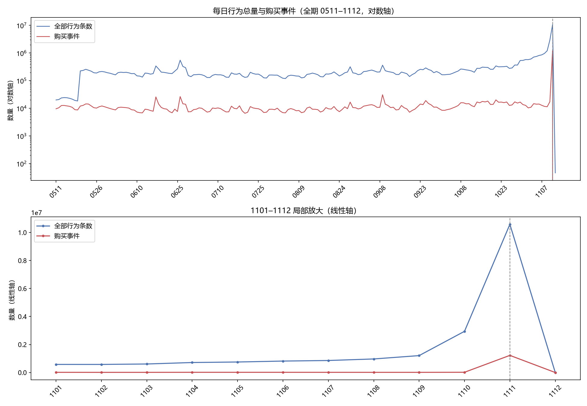
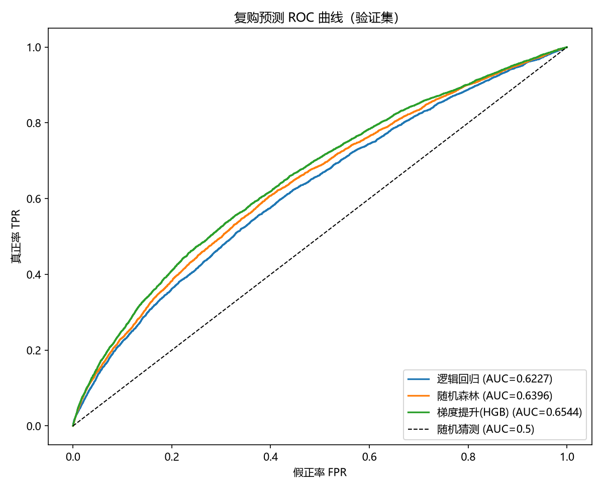
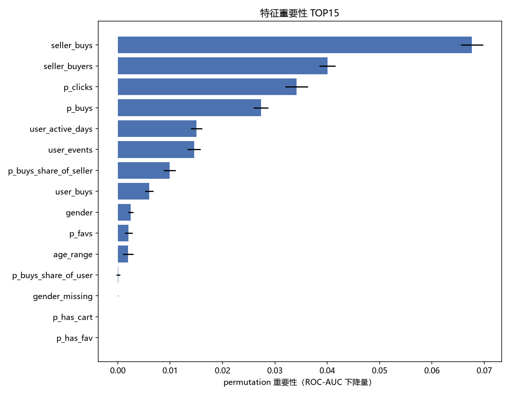
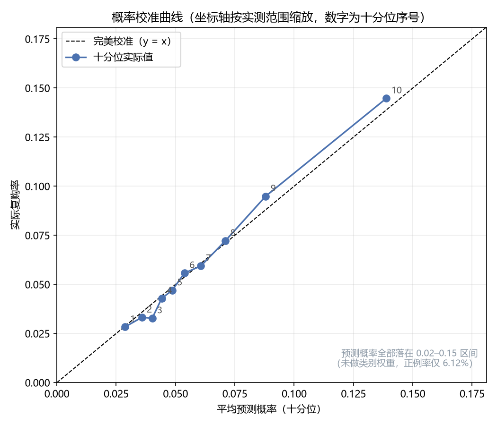

# 项目报告：国内电商用户行为分析与复购运营平台

> 数据来源：阿里云天池「天猫复购预测」公开数据集（已脱敏）。
> 报告内所有数字均由本项目代码从本地数据实际计算得出，可逐条复现。
> 分阶段细节见 `outputs/reports/phase{5,6,7,8}_*.md`，工程细节见 `docs/ENGINEERING_NOTES.md`。

---

## 一、摘要

用 5492 万条真实用户行为日志，回答一个具体的电商运营问题：**11.11 当天买过我的人，之后还会不会回来复购？**

完成的工作：

| 环节 | 结果 |
|---|---|
| 数据清洗 | 54,925,330 行，产物 SHA256 字节级可复现 |
| 数据库 | MySQL 星型模型 9 张表，**19 项硬校验全部 PASS** |
| SQL 分析 | 11 个章节，与 Python 结果逐项交叉验证一致 |
| 统计分析 | 11 张结果表 + 10 张图表 |
| 指标体系 | 指标字典（含 9 项「算不出来的指标」） |
| 预测建模 | 验证集 ROC-AUC **0.6544**，5 折 CV **0.6590 ± 0.0049** |
| 后端 | FastAPI 12 个接口，全部查真实库 |
| 前端 | Vue 3 看板，构建产物 85.6 kB（gzip 34 kB） |
| 测试 | 40 项（24 单元 + 16 集成），集成测试直连真实数据 |
| 部署 | 单端口，一个地址同时提供页面与接口 |

**三个最有价值的发现**（都不是常识，是从数据里数出来的）：

1. 这份数据的 424,170 个用户**全部是 11.11 当天有购买的用户**，所以「购买用户占比 100%」没有信息量。
2. 日志在 1111 就结束了（1112 仅 46 行），**复购标签无法用本日志重建**。
3. 0519 → 0520 有一次 **12.22 倍**的结构性断层，早期数据采集不完整，「全期日均」会严重低估后半段。

---

## 二、业务问题

电商运营的核心动作之一是「复购运营」：在有限预算下，把触达名额投给最可能回来的人。

要把它做成数据产品，需要回答三个层次的问题：

| 层次 | 问题 | 本项目对应产出 |
|---|---|---|
| 描述 | 用户都在什么时间、做了什么？ | Phase 5/6 趋势与行为结构 |
| 诊断 | 哪些品类/商家/人群表现更好？ | Phase 5/7 排名、分层、健康度 |
| 预测 | 具体某个用户会不会从某商家复购？ | Phase 8 模型 |

---

## 三、数据

| 文件 | 行数 | 内容 |
|---|---|---|
| `user_log_format1.csv` | **54,925,330** | 用户对商品的点击/加购/购买/收藏 |
| `user_info_format1.csv` | 424,170 | 年龄区间、性别 |
| `train_format1.csv` | 260,864 | 用户 × 商家 + 复购标签 |
| `test_format1.csv` | 261,477 | 待预测（`prob` 全空） |

**字段边界**（决定了后面能算什么、不能算什么）：

- 时间只有 `mmdd`（如 `0829`），**没有年份、没有小时**
- 没有会话 ID、订单号、金额、库存、地域
- 行为四类：点击 / 加入购物车 / 购买 / 加入收藏夹

行为分布实测：点击 48,550,713（88.39%）、加购 76,750（0.14%）、购买 3,292,144（5.99%）、收藏 3,005,723（5.47%）。
`brand_id` 缺失 91,015 条——**导入时用 `NULLIF` 转 NULL**，否则「缺失」会被写成「真实的 0」。

---

## 四、技术链路

```
CSV (2.3 GB)
   │  python/data_cleaning.py + clean_user_log.py（分块处理，内存安全）
   ▼
data/clean/*.csv  ← 产物 SHA256 与首轮完全一致，可复现
   │  sql/create_table.sql → load_data.sql → build_dims.sql
   ▼
MySQL 8.0  tmall_analysis（9 表，事实表 2.7 GB + 索引 5.3 GB，按 date_key 分区）
   │  sql/verify_data.sql（19 项硬校验）
   ├─► sql/analysis.sql        窗口函数 / 帕累托 / 分区裁剪
   ├─► python/analysis_stats.py 分块统计 + matplotlib（11 表 / 10 图）
   ├─► python/metrics_kpi.py    运营指标（RF 分层，非 RFM）
   └─► python/build_features.py → python/train_model.py
                                  21 个特征 → 17 个有效 → HGB 模型
          │
          ▼
   api/main.py（FastAPI 12 接口，重聚合物化成 3 张表）
          │
          ▼
   frontend/（Vue 3 + Vite，零图表库，手写 SVG）
```

---

## 五、关键发现

### 5.1 抽样口径：所有用户都是 11.11 买家

424,170 个用户**全部**在 1111 出现，且**每人至少一次购买**；1111 当天的用户集合与全量用户集合**完全相等**（用布尔矩阵与 Python 集合两套独立实现交叉验证）。

**影响**：任何「某行为 → 购买用户」的重叠率必然等于 100%，把它当转化率讲是错的；「购买用户占比 100%」也没有信息量。

### 5.2 观测窗口在 1111 结束

1112 仅 **46 行、0 次购买**。因此**无法用本日志构造「1111 之后是否再购买」的标签**，复购标签只能沿用比赛方给出的 `label`。这直接决定了建模方式：特征只能用 1111 及之前的行为。

### 5.3 0519 → 0520 有 12.22 倍结构性断层

| 日期 | 行为条数 | 日环比 |
|---|---|---|
| 0519 | 18,430 | -4.22% |
| **0520** | **225,198** | **+1121.91%** |

前 9 天日均 21,680 条，之后日均 309,210 条。判断为早期采集覆盖不完整。该结论由 pandas 与 MySQL `LAG()` 两套实现分别得出，一致。

**另一个口径细节**：日志名义覆盖 186 天，但 1112 只有 46 行、0 次购买，是数据截断的尾巴。所以所有「日均」类指标只统计**有效窗口 185 天**（`agg_daily.effective = 1`）：含 1112 是 295,297，排除后是 **296,893**。原始数据保持完整，只是显式打标记而不是悄悄过滤。

### 5.4 双十一：购买放大 88.98 倍，远超行为总量的 8.97 倍

| 指标 | 前 7 天日均 | 1111 | 倍数 |
|---|---|---|---|
| 行为条数 | 1,179,264 | 10,582,633 | 8.97× |
| 购买事件 | 13,749 | 1,223,354 | **88.98×** |
| UV | 95,718 | 424,170 | 4.43× |

购买放大倍数远高于行为总量，说明 1111 不只是「人变多」，更是**单位行为的转化效率提升**。
但 UV 的 4.43× 是错觉——那天等于全量用户（见 5.1）。



### 5.5 老客复购率显著高于新客

以「1111 前是否有购买」分层（因为全期「最近一次购买」恒为 1111，没有区分度，只能用 R_pre）：

| 分层 | 样本数 | 复购数 | 复购率 |
|---|---|---|---|
| 老客 | 211,874 | 13,553 | **6.40%** |
| 新客 | 48,990 | 2,399 | 4.90% |

差 **+1.50 个百分点**。

**这个差异是噪声吗？** 不是。两项比例检验：**z = 12.49，p ≈ 8.9e-36**，差值 95% 置信区间 **[1.28, 1.72] 个百分点**（标准误 0.111 pp）。

但要讲清楚三层意思：

1. 这是 260,864 个样本上的**精确观测差**，不是抽样估计；
2. 若推断到未来同类用户，差异在统计上极显著；
3. **显著 ≠ 因果**——样本量大到 26 万时 1.5 个百分点也会高度显著，而且两个分组不是随机分配的（老客本来就可能更活跃），存在混杂因素。要回答"让用户先买一次能否提高复购"，需要对照实验，本数据做不到。

### 5.6 品类与商家都极度分散

| 维度 | 数量 | HHI | TOP10 份额 |
|---|---|---|---|
| 品类 | 1,324 | 104.83 | 23.21% |
| 商家 | 4,995 | 8.60 | 4.28% |
| 品牌 | 6,908 | 16.80 | 8.02% |

HHI 全部远低于 1500，**不存在垄断型玩家**。这意味着「押注头部商家」的策略在这份数据里没有依据。

### 5.7 小样本会造出假极值

| 商家样本量 | 商家数 | 平均复购率 | 最高复购率 |
|---|---|---|---|
| ≥500 | 111 | **7.11%** | 29.04% |
| 100–499 | 476 | 5.42% | 28.19% |
| 30–99 | 927 | 5.22% | 43.24% |
| **<30** | 479 | 5.57% | **52.94%** |

样本量 <30 的组里出现 52.94% 的极端值——纯粹的小样本噪声。**这就是为什么所有商家排行榜都必须先过滤 `samples >= 30`**，否则第一名可能是只有两三个样本的商家。

---

## 六、建模

### 6.1 任务定义

样本单位是 `(user_id, merchant_id)` 对，预测 `label=1`（复购买家）的概率。正例率 **6.12%**。

### 6.2 特征工程

从 5492 万行日志聚合到 52 万样本对，共 21 个特征。**剔除 3 个零方差特征**：

| 特征 | 问题 |
|---|---|
| `p_has_buy` | 全部 260,864 条训练样本都是 1 |
| `p_last_buy_recency` | 全部是 0 |
| `p_last_recency` | 260,864 条里 260,862 条是 0 |

原因：**所有样本都满足「该用户已在该商家买过」**——这正是比赛设定。留着它们只会污染特征重要性。

有效特征 17 个：该用户对该商家的四类行为次数、是否加购/收藏、用户级购买力与活跃度、商家体量、两个占比特征、用户画像（年龄、性别及缺失标记）。

**没有用任何 target 派生特征**——比如「该商家的历史复购率」看似好用，但它是用 label 算出来的，属于泄漏，一律不用。

### 6.3 结果

| 模型 | ROC-AUC | PR-AUC |
|---|---|---|
| 基线：全预测 0 | 0.5000 | 0.0612 |
| 基线：规则排序 | 0.5530 | 0.0826 |
| 逻辑回归 | 0.6227 | 0.1054 |
| 随机森林 | 0.6396 | 0.1117 |
| **梯度提升 HGB** | **0.6544** | **0.1196** |

5 折 CV ROC-AUC **0.6590 ± 0.0049**。

**产物与指标的对应关系**（容易混，必须说清）：落盘的 `repurchase_model.joblib` 是**全量训练集**拟合的版本，与 `prediction_test.csv` 同源；而上表的 holdout 指标来自 **70% 训练集**那一次拟合——那是唯一可以无偏评估的版本。两个数字都对，但引用时不能张冠李戴。元信息见 `outputs/models/repurchase_model_meta.json`（含特征列表、训练行数、正例率、库版本）。

**只触达分数最高 10% 人群**（运营真正关心的场景）：命中 1,133 个正例，精确率 0.1448、召回率 0.2367，是随机挑选的 **2.37 倍**。



### 6.4 一个容易犯的评估错误

固定 0.5 阈值时，HGB 的精确率和召回率**都是 0**——它没做类别权重，概率整体压在 0.5 以下，一个正例都不报。

如果据此判定「模型无效」就错了：它的排序能力是最好的。按「预测正例率 = 训练集正例率」重新定阈值后，F1 是三个模型里最高的（0.1665）。

**在 6.12% 正例率下用 0.5 阈值评判模型，是常见的方法错误。**

### 6.5 特征重要性

permutation 重要性（打乱后 ROC-AUC 的下降量）：

| 特征 | 重要性 |
|---|---|
| `seller_buys`（商家被购买总次数） | 0.0676 |
| `seller_buyers`（商家去重买家数） | 0.0400 |
| `p_clicks`（对该商家的点击次数） | 0.0341 |
| `p_buys`（对该商家的购买次数） | 0.0273 |
| `user_active_days`（用户活跃天数） | 0.0150 |

**商家体量比用户个体行为更重要**——对运营的含义是：提升复购要先看商家分层，而不是只盯单个用户的行为。



### 6.6 概率校准：概率能不能直接当预期值用

ROC-AUC 只衡量**排序能力**，不说明「预测 0.15 的用户是否真的约 15% 会复购」。如果要用概率算期望人数、分配预算或做 ROI 估算，必须单独看校准。

| 指标 | 值 | 说明 |
|---|---|---|
| Brier 分数 | **0.05612** | 越小越好 |
| 常数预测基准线 | 0.05742 | 永远预测正例率 6.12% 的成绩 |
| 相对改善 | 2.3% | 提升幅度有限 |

按预测概率十分位分组：

| 十分位 | 样本数 | 平均预测概率 | 实际复购率 | 偏差 |
|---|---|---|---|---|
| 1 | 7,826 | 0.0288 | 0.0284 | -0.0004 |
| 2 | 7,826 | 0.0358 | 0.0332 | -0.0026 |
| 3 | 7,826 | 0.0402 | 0.0328 | -0.0074 |
| 4 | 7,826 | 0.0442 | 0.0429 | -0.0013 |
| 5 | 7,826 | 0.0486 | 0.0470 | -0.0016 |
| 6 | 7,826 | 0.0538 | 0.0558 | +0.0020 |
| 7 | 7,826 | 0.0607 | 0.0594 | -0.0013 |
| 8 | 7,826 | 0.0710 | 0.0722 | +0.0012 |
| 9 | 7,826 | 0.0880 | 0.0949 | +0.0069 |
| 10 | 7,826 | **0.1389** | **0.1448** | +0.0059 |

**两个结论合起来看才有用：**

1. **校准本身不错**：十个分位的偏差绝对值最大只有 0.0074，最高分位预测 13.89%、实际 14.48%。**概率基本可信，不只是排序可用**——这一点比 AUC 更能说明模型有实用价值。
2. **但区分度有限**：Brier 只比基准线好 2.3%，说明绝大多数样本的预测都贴近 6.12% 的基准率。这与 AUC 0.65 是同一个事实的两种度量。

所以正确的用法是：**按概率分档做预算分配与期望人数估算可行，但不要指望它对单个用户给出尖锐判断**。



### 6.7 稳健性：0.65 是不是某次划分撞上的

单次 5 折 CV 的均值会被划分随机性影响。改用 **5 折 × 3 轮 = 15 次**重复评估：

| 指标 | 值 |
|---|---|
| 15 次 ROC-AUC 均值 | **0.6595** |
| 标准差 | 0.0038 |
| 最小值 | 0.6501 |
| 最大值 | 0.6648 |

15 次结果的极差只有 **0.0148**。也就是说 0.66 附近是模型本身的能力水平，不是某一次数据划分碰巧撞上的高值。

### 6.8 特征共线性：为什么前两名特征的重要性都偏低

用方差膨胀因子衡量每个特征能被其余特征线性解释的程度（VIF = 1/(1−R²)，>10 视为严重）：

| 特征 | VIF | R² |
|---|---|---|
| `seller_buys` | **20.60** | 0.9515 |
| `seller_buyers` | **20.47** | 0.9511 |
| `p_has_cart` | 3.42 | 0.7074 |
| `p_carts` | 3.41 | 0.7072 |
| `user_active_days` | 2.83 | 0.6463 |
| `user_events` | 2.70 | 0.6292 |
| `user_buys` | 2.11 | 0.5252 |
| `p_favs` | 1.64 | 0.3899 |

只有两个特征 VIF 超过 10，而这两个恰好就是重要性排名**第一和第二**的特征，两者相关系数高达 **0.974**。

这解释了 6.5 节里一个容易误读的现象：**permutation 重要性会在共线特征之间被摊薄**。单独打乱 `seller_buys` 时，`seller_buyers` 仍然保留了几乎相同的信息，模型表现不会掉太多，于是两者的重要性都只有 0.068 / 0.040。如果只看到"0.0676 这个数字很小"就断定特征没用，是误读——它们的**联合贡献**远大于单个数字。

相比之下 `p_carts` × `p_has_cart`（0.841）属于正常的设计性冗余：`p_has_cart` 就是 `p_carts > 0` 的二元化版本，保留它是为了让树模型能直接切一刀，代价可以接受。

### 6.9 翻译成业务语言

在验证集（78,260 条样本，4,786 个真实复购）上模拟不同触达预算：

| 触达比例 | 触达人数 | 命中正例 | 精确率 | 召回率 | 相对随机提升 | 较随机多命中 |
|---|---|---|---|---|---|---|
| 1% | 782 | 178 | 0.2276 | 0.0372 | **3.72×** | +130 |
| 5% | 3,913 | 673 | 0.1720 | 0.1406 | 2.81× | +434 |
| 10% | 7,826 | 1,133 | 0.1448 | 0.2367 | 2.37× | **+654** |
| 20% | 15,652 | 1,876 | 0.1199 | 0.3920 | 1.96× | +919 |
| 50% | 39,130 | 3,343 | 0.0854 | 0.6985 | 1.40× | +950 |

**读法**：只触达前 10%（7,826 人），模型命中 1,133 个真实复购用户；同样人数随机挑选只能命中约 478 个。**同样的触达预算，多捞回 654 个真实复购用户**。收窄到前 1% 时精确率升到基准率的 3.72 倍，适合做小规模高价值名单。

**边界**：这是离线模拟，不是线上收益。它假设触达本身不改变用户行为，也没有计入触达成本与后续转化漏斗。真实投放必须做 A/B 实验验证。

---

## 七、工程实现

### 7.1 数据库

9 张表（1 事实 + 6 维度 + 2 样本），另加 3 张物化聚合表。

三个非默认决策，都由实测驱动：

| 决策 | 依据 |
|---|---|
| 列类型用 `MEDIUMINT` / `SMALLINT` | 先扫全量测出 `user_id ≤ 424,170`、`cat_id ≤ 1,671`；比全用 `INT` 省约 440 MB |
| 事实表不建代理主键 | 分析只做聚合；重载用分区 `TRUNCATE`。再省近 1 GB |
| 按 `date_key` 分区，而非 `month` | 按 `month` 分区时 `date_key` 条件无法裁剪，`EXPLAIN` 显示 8 个分区全扫；改后只扫 `p11` 且 `Using index` |

### 7.1.1 执行计划审计（11 条查询逐条实测）

`python/explain_audit.py` 把 `sql/analysis.sql` 拆成单条语句，逐条 `EXPLAIN` 并可选实测耗时（`--time`），输出 [phase5_explain_audit.md](../outputs/reports/phase5_explain_audit.md)。

**审计结论：0 条问题、3 条关注、8 条 OK。** 事实表上的查询全部命中索引，未出现百万行级的 `type=ALL` 全表扫描；日期范围查询的分区裁剪全部生效。3 条「关注」都是 `GROUP BY` 后排序取 TOP N 的临时表 + 文件排序——属于聚合语义的必要代价。

**更重要的发现是耗时结构：**

| 查询 | 实测耗时 | 特征 |
|---|---|---|
| 总览（行数 + 去重用户） | 59.0 s | 全期累计 |
| 行为结构（4 次 `COUNT(DISTINCT)`） | **376.0 s** | 全期累计 |
| 每日趋势（日环比 + 7 日移动平均） | 51.2 s | 全期累计 |
| 双十一对比 | 60.7 s | 只扫 `p11`（2054 万行） |
| 品类/商家 TOP10、购买频次、分层 | 10.6–17.9 s | 走索引 + 排序 |

**这组数字说明瓶颈不在 SQL 写法。** 「全期累计」类查询必须扫完 5492 万行才能给出一个数字，加索引救不了——索引只能减少回表，不能减少要读的键值数量。所以正确解法是物化而非调优 SQL，这正是 7.2 节接口提速的来源。

### 7.2 后端性能

`COUNT(DISTINCT user_id)` 在 5492 万行上要 100 秒以上，放进接口等于不可用。

解法：把三类「算得慢、用得多」的聚合**物化成表**（4 行 / 2 行 / 186 行），排名接口再叠加内存缓存。

| 接口 | 优化前 | 优化后 |
|---|---|---|
| `/api/actions` | 100 s | **0.04 s** |
| `/api/daily` | 58 s | **0.03 s** |
| `/api/overview` | 36 s | **0.004 s** |

### 7.3 前端

Vue 3 + Vite，**不引任何图表库**，趋势图手写 SVG。打包 85.6 kB（gzip 34 kB），构建 0.6 秒。

两个实现细节：

- 趋势图用**对数纵轴**：日行为量跨 2 万 ~ 1058 万三个数量级，线性轴下除 1111 外全部被压平。
- 行为条用**对数宽度**：点击量是加购量的 632 倍，线性刻度下加购条肉眼不可见。

### 7.4 测试与部署

40 项测试分三层：**24 项单元测试**（不连数据库，约 2 秒，保护 `Decimal` 转换、特征列顺序、静态路由、交付物数字一致性、BI 导出逻辑）与 **16 项集成测试**（直连真实 5492 万行，断言绑定本文出现过的数字）。数据库不可用时集成测试 skip 而非 fail——环境问题不该被误判成代码回归。

部署简化为单端口：FastAPI 挂载前端构建产物，一个地址同时提供页面与接口；`/api/*` 不会被 SPA 兜底吞掉（未命中明确 404）。

另外提供两样保障：

- **CI**（`.github/workflows/ci.yml`）：每次 push 跑语法检查、前端构建、单元测试。集成测试因为需要 5492 万行数据，仓库里没有，故 CI 跳过。
- **环境自检**（`python/check_env.py`）：15 项检查，包括 MySQL 库内容是否 54,925,330 行、启动脚本编码是否正确（`.ps1` 必须带 BOM、`.cmd` 必须纯 ASCII + CRLF，这两个坑都踩过）。有阻塞项返回退出码 1。

---

## 八、踩过的坑

| 坑 | 现象 | 根因 | 解法 |
|---|---|---|---|
| 中文计算机名 | `mysqld` 启动失败，`OS errno 2` + `data directory is unusable` | MySQL 安装器把主机名（南笙离）写进 `log-error` / `log-bin` 等配置，非 ASCII 文件名创建失败 | 命令行参数覆盖成 ASCII 文件名（优先级高于配置文件） |
| 带索引装载 | 20 分钟只进 650 万行，推算 3 小时 | 分区表 + 6 个二级索引逐行插入，写放大严重 | 删索引 → 裸装 → 一次 `ALTER` 重建：**4.83 分钟** |
| 分区白建 | `EXPLAIN` 扫全部 8 个分区 | 分区键是 `month`，查询条件用 `date_key`，优化器无法反推 | 改 `RANGE(date_key)` |
| PowerShell 编码 | `.ps1` 里变量莫名变 `null` | PowerShell 5.1 对无 BOM 文件按 GBK 解码，中文注释吃掉换行符，把下一行代码并进注释 | 存成 UTF-8 **带 BOM** |
| cmd.exe 解析 | `.cmd` 被拆成乱码命令 | 写成 LF 换行 + 中文注释 | 改成 ASCII + **CRLF** |
| `LOAD DATA` | `ERROR 2 (HY000) ... not found` | 项目路径含中文，客户端按 ANSI 转换后打不开 | 改用相对路径 |

---

## 九、局限性

### 9.1 这份数据算不出来的（严禁编造）

| 指标 | 原因 |
|---|---|
| GMV / 客单价 / ARPU | 没有金额字段 |
| 会话级转化率、跳出率 | 没有会话 ID |
| 订单量、退款率 | 没有订单号 |
| 留存率 | 没有注册日期，也没有 1111 之后的窗口 |
| 工作日 vs 周末 | 只有 mmdd，没有年份 |
| 小时级流量 | 没有小时字段 |

### 9.2 模型局限

1. **AUC 0.65 不算高，这是数据决定的**：正例率仅 6.12%，特征窗口只到 1111，而复购行为发生在窗口之外。
2. **没有做时间外验证**：样本本身不带时间戳，只能用分层随机划分；若实际投放有时间先后，效果可能下降。
3. **不能当因果用**：「购买次数多 → 复购率高」不代表多买几次就能提升复购。

### 9.3 已明确标注的「假信号」

- 「购买用户占比 100%」是抽样口径的必然结果
- 「加购→购买重叠率 100%」同样是退化结果
- 「1111 拉新 4.43 倍」是错觉，那天 UV 等于全量用户
- 「小样本商家复购率 52.94%」是噪声

---

## 十、产出清单

| 类型 | 数量 | 位置 |
|---|---|---|
| SQL 脚本 | 6 | `sql/` |
| Python 脚本 | 12 | `python/` |
| 后端 | 1 | `api/main.py` |
| 前端 | 14 个文件 | `frontend/` |
| 测试 | 40 项（24 单元 + 16 集成） | `tests/` |
| CI | 1 个工作流 | `.github/workflows/ci.yml` |
| 分析报告 | 4 份 | `outputs/reports/` |
| 图表 | 15 张 | `outputs/charts/` |
| 中间结果表 | 25 张 CSV | `outputs/tables/` |
| 文档 | 6 份 | `docs/` + `README.md` |
| BI 数据 | 9 张 CSV | `outputs/bi/` |

---

## 十一、复现

```powershell
# 1. 环境
.\.venv\Scripts\python.exe -m pip install -r requirements.txt

# 2. 数据库（不需管理员）
.\start_mysql.cmd

# 3. 建库导入（约 15 分钟）
& $mysql -u root -h 127.0.0.1 -P 3306 --default-character-set=utf8mb4 < sql\create_table.sql
& $mysql -u root -h 127.0.0.1 -P 3306 --default-character-set=utf8mb4 --local-infile=1 < sql\load_data.sql
& $mysql -u root -h 127.0.0.1 -P 3306 --default-character-set=utf8mb4 < sql\build_dims.sql
& $mysql -u root -h 127.0.0.1 -P 3306 --default-character-set=utf8mb4 < sql\verify_data.sql   # 19 项校验

# 4. 分析与建模
.\.venv\Scripts\python.exe python\analysis_stats.py
.\.venv\Scripts\python.exe python\metrics_kpi.py
.\.venv\Scripts\python.exe python\build_features.py
.\.venv\Scripts\python.exe python\train_model.py

# 5. 服务与页面
& $mysql -u root -h 127.0.0.1 -P 3306 --default-character-set=utf8mb4 < sql\build_aggregates.sql
.\start_api.cmd          # 打开 http://127.0.0.1:8000

# 6. 测试
.\.venv\Scripts\python.exe -m pytest tests -v
```
